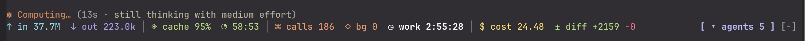
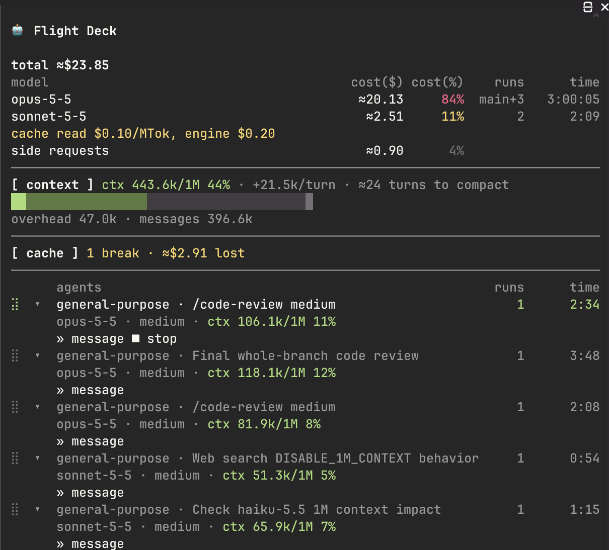
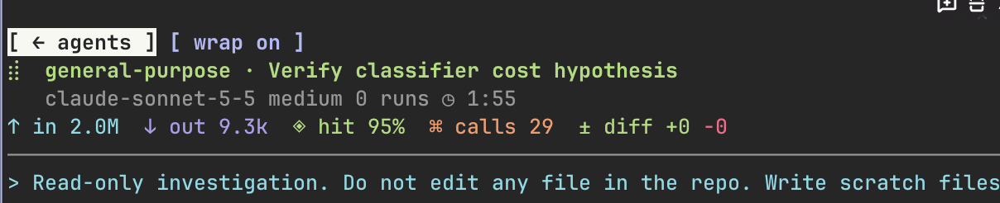
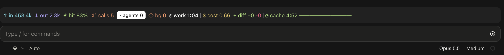
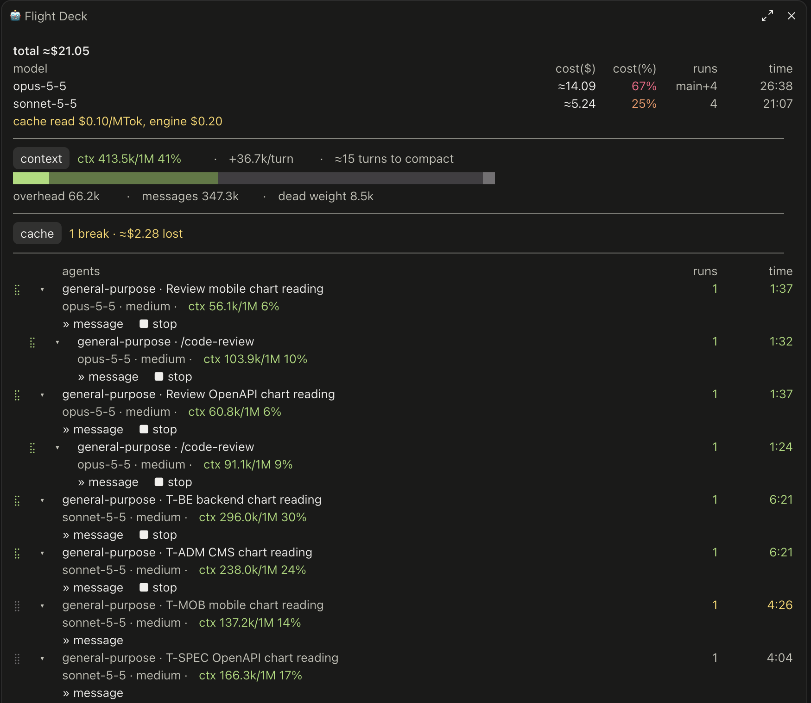
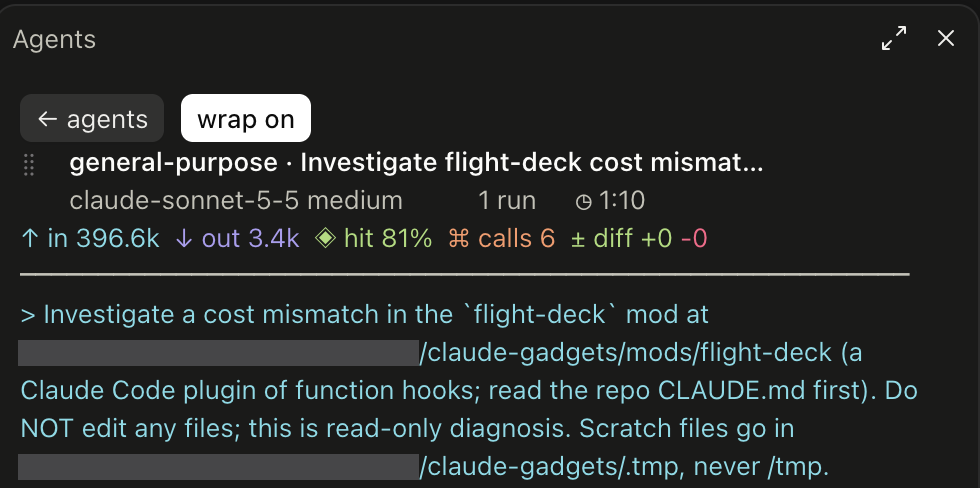

# claude-gadgets

English · [Tiếng Việt](docs/i18n/README.vi.md)

Mods (hot-reloadable plugins) for Claude Code. Each mod is a self-contained plugin under `mods/<name>/`.

## Mods

| Mod | What it does |
| --- | --- |
| `flight-deck` | Band above the prompt: input/output/cache-hit tokens, tool calls, started subagents and background tasks, model working time, session cost, lines changed by file tools and a styled prompt-cache countdown. The totals include each subagent. When the transcript of a subagent is on the screen, the band shows the numbers of that subagent and of the agents below it. Data survives resume. |
| `verdict-gate` | Auto mode: when the safety classifier gives no verdict for a tool call, a dialog asks you to run the call once, to run each such call for the session, or to refuse it. A call that the classifier judged unsafe stays denied. |

## Toolchain

Bun, TypeScript 7 and Biome, every dependency pinned to an exact version (`bunfig.toml` sets `exact = true`).

```sh
bun install --frozen-lockfile
bun run check      # biome + tsc + claude plugin validate + claude plugin test
```

`tsc` needs the engine's typings in `mods/<name>/.claude-plugin/types/claude-code/index.d.ts`. Claude Code writes them when it loads a mod; to type-check before the first load, copy the file the `plugin-authoring` skill names (it is gitignored).

## Install

Run these commands in Claude Code:

```text
/plugin marketplace add tunglt1810/claude-gadgets
/plugin install flight-deck@claude-gadgets
/plugin install verdict-gate@claude-gadgets
/reload-plugins
```

A mod starts when the plugins load again. If a mod does not show, start Claude Code again.

A mod is code that runs in Claude Code on your machine, with the access that Claude Code has. Read the source before you install it.

The mods are tested on Claude Code 2.1.296.

## Loading a mod from a clone

Use one source for a mod: the installed plugin or a directory, not the two together.

- CLI: `claude --plugin-dir mods/flight-deck` (hot reloads on save).
- Claude Desktop (Code tab): set `CLAUDE_CODE_PLUGIN_DIRS` to the absolute mod path in the `env` block of `~/.claude/settings.json`.

`flight-deck` option `cacheTtl` is `1h` (default) or `5m`. Set `5m` when your session uses the 5-minute prompt cache.

## Agents pane

`flight-deck` has a pane that shows the subagents of the session.

- Press `◆ agents N` on the band, or run `/agent-log`, to open the pane. Do the same to close it.
- The pane lists the subagents as a tree. A child agent is below its parent.
- Press an agent to see its transcript. Press a tool call to see its input and its result.
- Each agent row has a detail row, open at first, and an expand button that hides or shows it. The detail row shows the model, the effort and the context length of the agent (`ctx 182.4k/1M 18%`). The color is green below 50%, yellow from 50% and red from 80%.
- The transcript screen shows the same context length below the title.
- An open agent row has two controls. `» message` opens a field: type a message and press Enter to send it to the agent. An agent that completed starts again. `■ stop` stops a running agent on its second press.
- The transcript screen has the two buttons in its toolbar, and in the bar that stays in view while it scrolls. `» message` opens the message field as the last row of the header, and the field stays in view below that bar while the transcript is scrolled.
- The pane shows an agent after it completes, after a new message starts it again, and after `--resume`.

Limits:

- An agent that started before the mod loaded is not in the list.
- In auto mode the engine does not send a message from the pane. The pane then shows the button `allow messages in auto mode`. Press it one time: the mod keeps your answer and sends the messages of the pane. A message that the model sends stays under the check of the engine. The answer is for all sessions. To take it back, delete `allowSend` from the store file of the mod (`plugins/store/flight-deck_*.json` in the configuration directory of Claude Code).
- `» message` puts the cursor in the message field only while the prompt of the session is empty. With text in the prompt, click the field.
- Each answer of an agent, and each stop, makes the main loop run one turn: the engine sends it a notification.
- The engine does not let a mod read the agents of a workflow run. The same is true for a teammate in its own terminal pane. The pane shows the refusal text of the engine.

## Context screen

The pane shows what fills the context window of the main loop.

- Below the dashboard, a block shows the context length (`ctx 226.9k/400k 57%`), a bar and three totals.
- The window is the compaction window: the count that you set with `/autocompact`, or the window of the model. Thus the numbers agree with the context window of Claude Desktop.
- The bar shows the messages, the system tools, the MCP tools and the skills each in a color, the rest of the content in grey, then the room that auto-compaction keeps and the free room.
- The first row also shows the growth of a turn, the tokens before auto-compaction (`140.1k to compact`) and the turns before it.
- The overhead is the content that each request carries before the conversation: the system prompt, the tools, the memory files and the skills.
- Press `context` to see each row of the window with its share (`window(%)`). Press a row with a `▸` mark to see its MCP servers, its memory files or its skills.
- `carry($)` is an estimate of what an overhead row cost in this session: its tokens, multiplied by the steps of the main loop and by the cache read price.
- `dead weight` lists the MCP servers that have loaded tools and that the session did not call.
- The screen opens with a full count, which sends one token-count request for each tool and each memory file. Press `recount` to count again.

Limits:

- The numbers are for the main loop. The engine gives no breakdown of the context of a subagent.
- A tool that loads on demand is not in the window. Its row (`deferred`) has no share.
- The context length of a subagent uses the window of its model.

## Cache screen

A cache break is a step of the main loop that reads much less from the prompt cache than the step before it wrote or read. The API then writes the prompt again, at the cache write price.

- The band shows `✗` and the cause after a break.
- Press `cache` on the agents screen to see each break of the session.
- The causes: `compact` (a compaction), `history` (messages were removed), `model` (another model), `ttl` (the cache expired), `tools` (the tool list changed), `prompt` (the system prompt changed), `context` (an instruction file or the date changed), `unknown`.
- `rewritten` is the tokens that the API wrote again. `lost($)` is an estimate: their cost as cache writes less their cost as cache reads.
- The mod finds the breaks of the main loop only. A subagent has its own cache.

## No-verdict question

`verdict-gate` is for auto mode. Load it with `claude --plugin-dir mods/verdict-gate`.

When the safety classifier gives no verdict for a tool call, the engine denies the call. The mod then shows a question with the `No verdict` chip and the whole input of the call as JSON. A character that is not printable ASCII shows as its code point (`\u{202e}`).

| Answer | Result |
| --- | --- |
| `Run once` | The call runs in the same turn. |
| `Do not ask again: <rule>` | The call runs. For this session, a later call with the same rule and no verdict runs with no question, and a toast names the rule. |
| `Do not run` | The denial stays, and the model gets an instruction not to issue the call again. |

A rule is a tool name (`Read`), or a Bash command with its subcommand (`Bash(git push:*)`). A compound command, a command with no subcommand and a command behind a wrapper such as `sudo` or `bash` get no rule. A rule lives in memory until the session or the mod reloads.

A call that the classifier judged unsafe, a call that you rejected and a tool that ran and failed get no question. An input longer than 2000 characters gets none.

## Adding a mod

Run the `/new-mod <name>` skill, or copy `mods/flight-deck` and trim it. Rules the engine enforces: the `types` contract is self-contained (no imports), helpers that take `$` are module-level function declarations, and plugin files link with static `import` only.

## Layout

```
mods/<name>/{.claude-plugin/plugin.json, hooks/, src/, types/index.d.ts, tsconfig.json}
docs/specs/   design specs
docs/plans/   implementation plans
docs/i18n/    translations of this README
```

## Preview

### Claude Code CLI

- Main view


- Agent dashboard


- Agent transcript view


### Claude Desktop

- Above prompt bar


- Agent dashboard


- Agent transcript view


## License

[MIT](LICENSE)